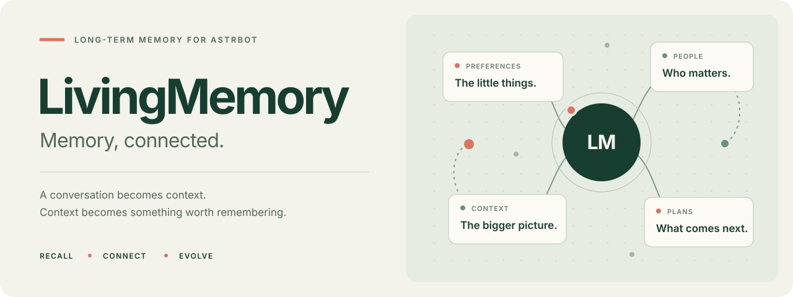

  <strong>中文</strong> · <a href="README_en.md">English</a> · <a href="README_ru.md">Русский</a>

  <a href="https://lxfight-s-astrbot-plugins.github.io/astrbot_plugin_livingmemory/"><strong>使用文档</strong></a> ·
  <a href="https://lxfight-s-astrbot-plugins.github.io/astrbot_plugin_livingmemory/webui"><strong>管理界面</strong></a> ·
  <a href="https://github.com/alva-lorenz-nl/astrbot_plugin_livingmemory/commits/main"><strong>版本记录</strong></a> ·
  <a href="https://github.com/alva-lorenz-nl/astrbot_plugin_livingmemory/issues"><strong>问题反馈</strong></a>

  
  
  

> [!IMPORTANT]
> **本仓库是社区修改版 —— 对话线（Conversation ID）隔离版，不是官方上游。**
> 代码基于原作者 lxfight 的 [astrbot_plugin_livingmemory](https://github.com/lxfight-s-Astrbot-Plugins/astrbot_plugin_livingmemory) **v2.13.0**，并在其上重新移植了对话线记忆隔离：写入、召回、反思与图谱都按 `conversation_id` 分域，不同会话（不同群、私聊、不同话题线）之间的记忆不会互相串味。
> 版本号标为 **2.13.1**；上游后续更新需要手动合并，请勿把本仓库的 Issue 提给原作者。
>
> **安装方式**：在 AstrBot 插件管理中选择「从 URL 安装」，填入 `https://github.com/alva-lorenz-nl/astrbot_plugin_livingmemory`；或克隆到 AstrBot 的 `data/plugins/` 目录后重启，并补装 `requirements.txt` 中的依赖。

## 让对话留下有用的记忆

LivingMemory 为 AstrBot 保存长期偏好、人物关系、项目进展和历史约定。它从对话中整理记忆，在需要时结合关键词、语义和图谱召回，并通过归档、衰减和访问强化管理记忆生命周期。

> **本仓库当前版本：2.13.1（社区对话线隔离版）** 
> 以 2.13.0 为基线重新移植对话线隔离，其余功能与上游一致。 
> [提交记录](https://github.com/alva-lorenz-nl/astrbot_plugin_livingmemory/commits/main) · [问题反馈（本仓库）](https://github.com/alva-lorenz-nl/astrbot_plugin_livingmemory/issues) · [上游仓库](https://github.com/lxfight-s-Astrbot-Plugins/astrbot_plugin_livingmemory)

## 从记住，到想起来

- **自动整理** — 达到配置的对话轮次后生成长期记忆；重要记录可保留原文，方便核验和重新总结。
- **按上下文召回** — 文档与图谱都支持关键词和向量检索，融合排序后结合会话、人格和生命周期筛选。
- **主动回忆与写入** — Agent 可调用 `recall_long_term_memory` 和 `memorize_long_term_memory`，按需读写长期记忆。
- **看得见、可维护** — 在官方插件视图中浏览 2D/3D 图谱、点击节点变焦并查看关联记忆，以及编辑记忆、测试召回、管理提示词和查看系统状态。

## 与上游的差异

- **对话线维度**：记忆的写入、召回、反思、归档与图谱查询都会带上 `conversation_id`，同一人格在不同会话里的记忆互不干扰。
- **升级路径**：以 2.13.0 为基线重新移植，数据库结构只做增量字段补充，首次启动自动迁移，不需要重建索引。
- **其余功能**：命令、配置项、注入格式与上游保持一致，可以对照上游文档使用。
- **维护方式**：上游发布新版本后，本仓库不会自动跟随，需要手动合并后再发版。

## 一个工作区，四种风格

**macOS 26 · 液态玻璃** 的浮动玻璃与壁纸，**Studio · 轻盈** 的柔和卡片，**Paper · 书页** 的暖纸色与衬线标题，或 **Terminal · 终端** 的等宽字体和仪表布局。

每种风格均支持浅色、深色与自动模式。点击管理页面的「外观与主题」即时切换，偏好保存在当前浏览器。放大图谱时标签保持稳定，手机端也能筛选会话、定位记忆和完成管理操作。

3D 图谱使用独立的暖光空间，支持旋转、缩放、节点聚焦和关联记忆查看；大量节点与关系通过 GPU 批量绘制。

[查看主题与操作指南 →](https://lxfight-s-astrbot-plugins.github.io/astrbot_plugin_livingmemory/webui)

## 开始使用

1. 从 AstrBot 插件市场安装，或将指定版本的插件代码放入 `data/plugins/astrbot_plugin_livingmemory`。
2. 先在 AstrBot 后台「模型提供商 → 嵌入」中创建并启用 Embedding Provider（推荐免费的 `BAAI/bge-m3`，见[配置步骤](https://lxfight-s-astrbot-plugins.github.io/astrbot_plugin_livingmemory/guide/embedding-model)），再重载 AstrBot 并在 LivingMemory 配置中填写其 ID 与 LLM Provider；Embedding 留空只会回退到第一个可用 Provider，容易选错或导致向量/图索引初始化失败。
3. 打开 `插件 → LivingMemory → 视图 → dashboard`（旧版 AstrBot 显示为 `Pages`）。插件视图需要 **AstrBot 4.24.2 或更高版本**。

测试版请从上方指定标签下载，具体安装及回退步骤见[版本与升级](https://lxfight-s-astrbot-plugins.github.io/astrbot_plugin_livingmemory/releases)。已有数据时，升级前保留插件数据与配置备份。

发送几轮对话后，用 `/lmem status` 查看状态、`/lmem summarize` 手动总结、`/lmem search 关键词` 检查召回。

## 免费的嵌入模型

LivingMemory 的语义召回依赖 Embedding Provider，推荐硅基流动当前免费的 `BAAI/bge-m3`（1024 维）。在 AstrBot「模型提供商 → 嵌入 → 新增模型提供商 → OpenAI Embedding」中填写：

- Provider ID：保留 AstrBot 生成的值，如 `openai_embedding`
- API Base URL：`https://api.siliconflow.cn/v1`
- API Key：硅基流动控制台创建的密钥
- 嵌入模型：`BAAI/bge-m3`
- 嵌入维度：`1024`

保存并点击测试后，把该 Provider ID 填入 LivingMemory 的 `provider_settings.embedding_provider_id`。模型 ID 与 Provider ID 不同，完整说明见[嵌入模型与 BGE-M3](https://lxfight-s-astrbot-plugins.github.io/astrbot_plugin_livingmemory/guide/embedding-model)。

## 继续了解

[快速开始](https://lxfight-s-astrbot-plugins.github.io/astrbot_plugin_livingmemory/guide/getting-started) · [配置参考](https://lxfight-s-astrbot-plugins.github.io/astrbot_plugin_livingmemory/configuration) · [命令速查](https://lxfight-s-astrbot-plugins.github.io/astrbot_plugin_livingmemory/commands) · [技术架构](https://lxfight-s-astrbot-plugins.github.io/astrbot_plugin_livingmemory/architecture) · [更新记录](CHANGELOG.md)

从 v1.4.0–v1.4.2 升级时，请先查看[备份与迁移说明](https://lxfight-s-astrbot-plugins.github.io/astrbot_plugin_livingmemory/configuration#备份迁移与清理)。

---

社区支持：QQ 二群 `1129994749`（新群） · [QQ 一群 953245617](https://qm.qq.com/cgi-bin/qm/qr?k=WdyqoP-AOEXqGAN08lOFfVSguF2EmBeO&jump_from=webapi&authKey=tPyfv90TVYSGVhbAhsAZCcSBotJuTTLf03wnn7/lQZPUkWfoQ/J8e9nkAipkOzwh)（已满） · 口令：`lxfight` 
开源许可证：[AGPL-3.0](LICENSE)
